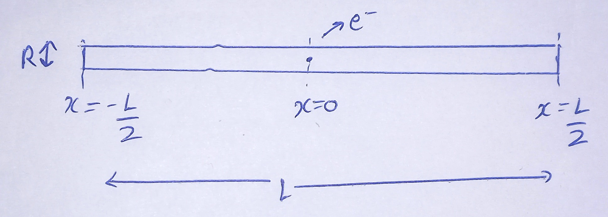
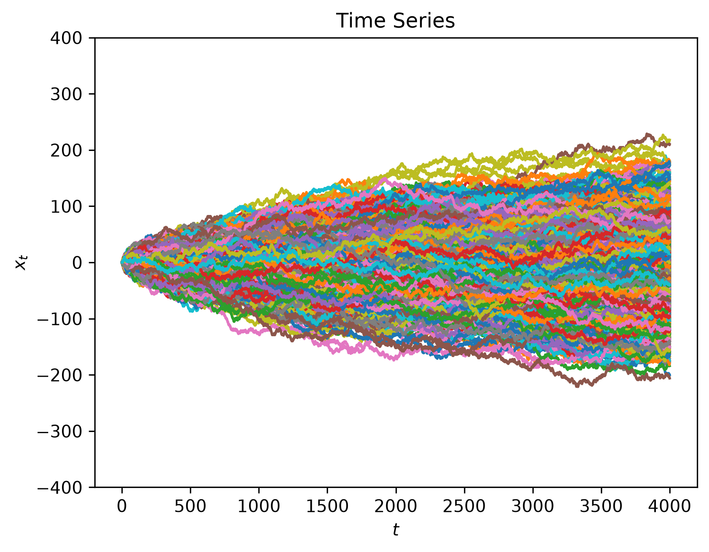
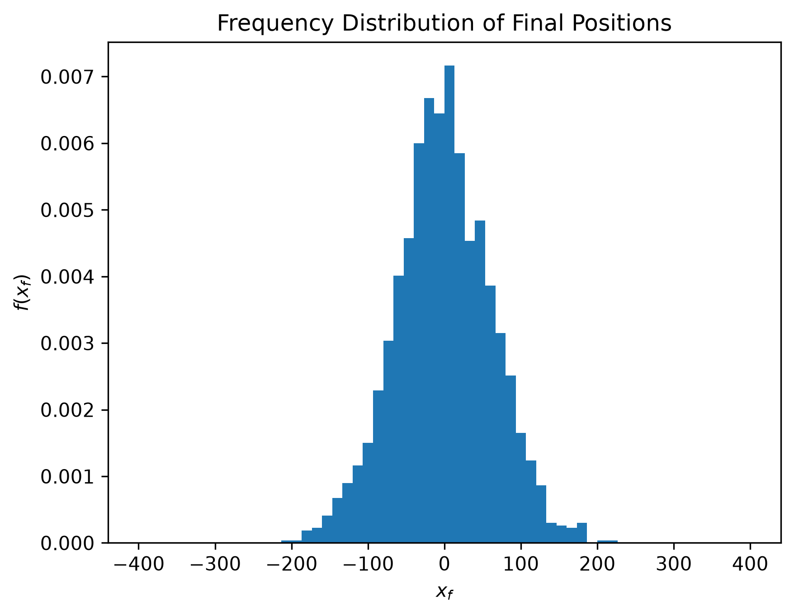
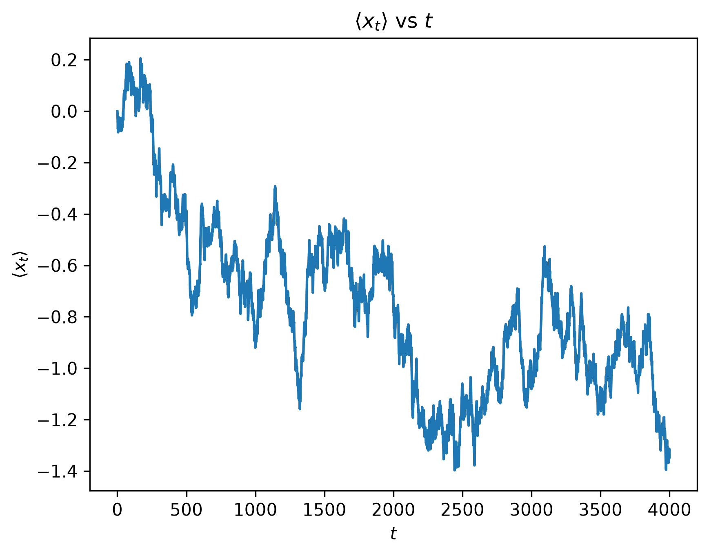
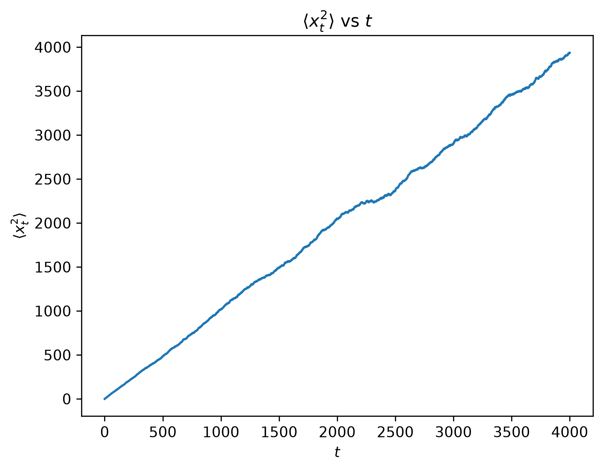

# Model 1

$R \ll L$

## Inputs
- Time step $= \Delta t$
- Step length $= \Delta x$
- $P_+ = \frac{1}{2}$
- $P_- = \frac{1}{2}$
- Number of steps $= N$
- Length of wire $= L$

## Required Outputs
- Frequency distribution of Final Positions
- $\langle x_t \rangle$ vs $t$
- $\langle x_t^2 \rangle$ vs $t$
- $\langle x_f \rangle$
- $\langle x_f^2 \rangle$

## Expected Outputs
[]

## Code
In `model1.py`.

## Computed Outputs
- $\Delta t = 1$
- $\Delta x = 1.0$
- $P_+ = 0.5$   
- $P_- = 0.5$   
- $N = 4000$
- $L = 800.0$

## Observation
$\langle x \rangle$ vs $t$ is linear with slope of $\frac{(\Delta x)^2}{\Delta t}$.\
We define, **diffusion constant**, $D = \frac{(\Delta x)^2}{2 \Delta t}$

## Mathematical Treatment
### Variance ($\sigma$) of Frequency Distribution of $x$
Final mean position is
$$\langle x_f \rangle = \frac{\int_{x_{min}}^{x_{max}} x_f f(x_f) \,dx}{\int_{x_{min}}^{x_{max}} f(x_f) \,dx}$$
Variance is
$$\sigma = \langle (x_f - \langle x_f \rangle)^2 \rangle = \frac{\int_{x_{min}}^{x_{max}} (x_f - \langle x_f \rangle)^2 f(x_f) \,dx}{\int_{x_{min}}^{x_{max}} f(x_f) \,dx}$$

### Collision Probability
$\mathbb{P}_{col}(x) = $ probability of two electrons to meet at $x$ after $N$ steps\
[TBDL]