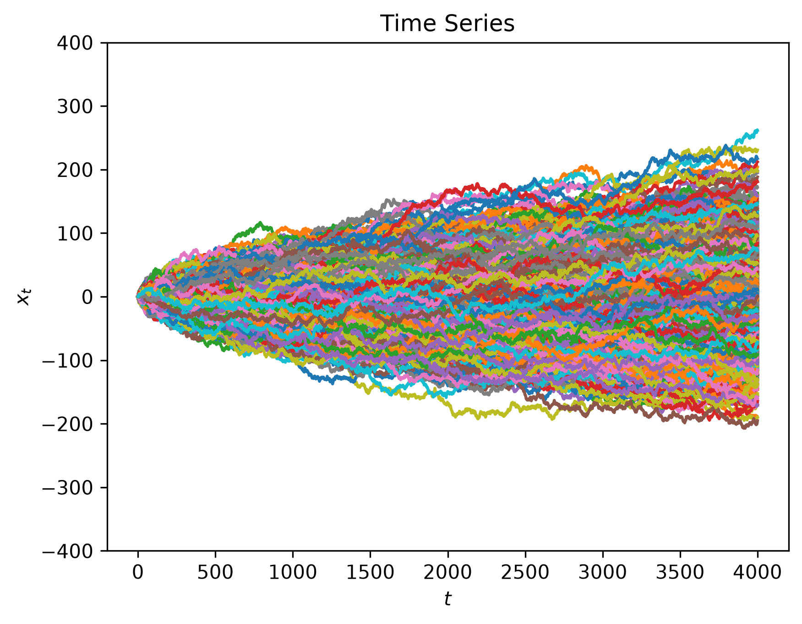
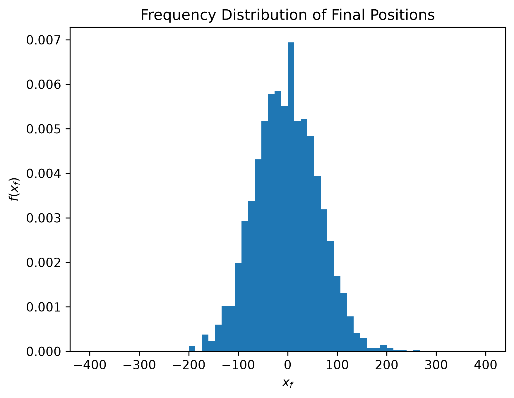
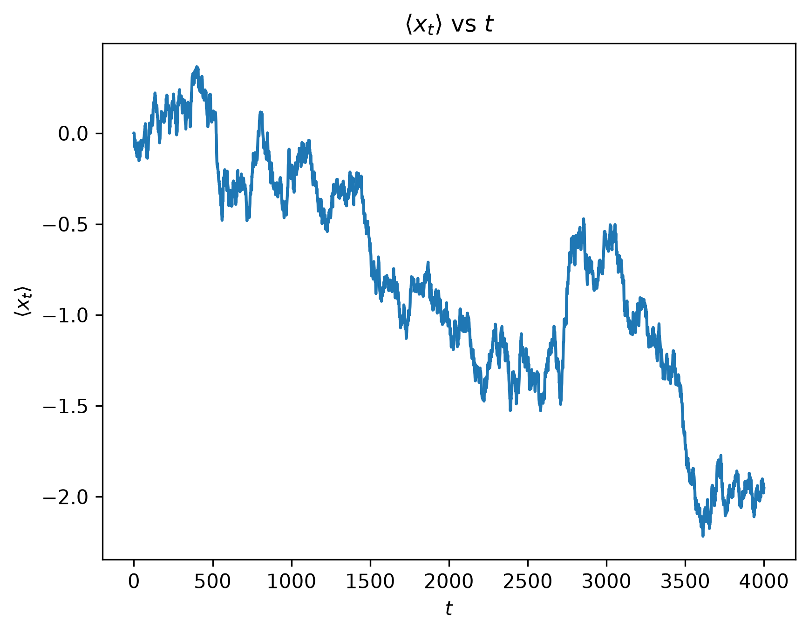
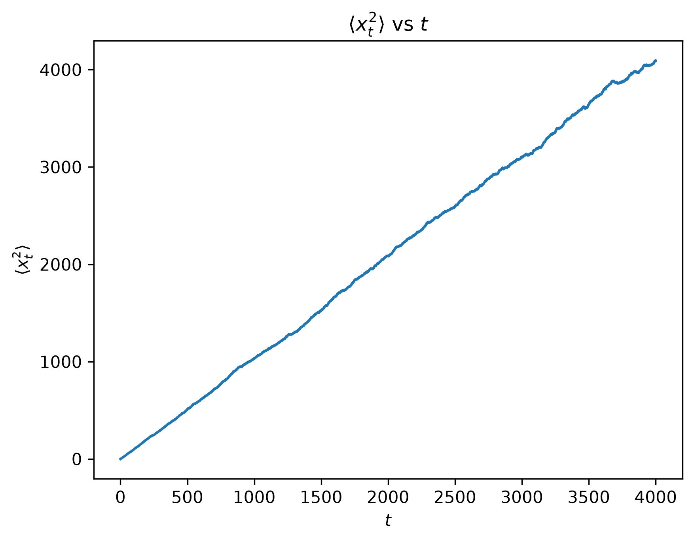

# Model 3
## Probabilistic $\Delta x$
In model 1,
$$P(\Delta x) = \left\{\begin{matrix} 1/2 \text{, if } \Delta x = -\Delta x_0, \Delta x_0 \\ 0, \text{otherwise} \end{matrix} \right\}$$
To get more realistic models, we should sample $\Delta x$ from a Gaussian distribution instead. It is described by
$$\boxed{P(\Delta x) = Ae^{-\frac{(\Delta x - \langle \Delta x \rangle)^2}{2 \sigma^2}}} \text{ such that } \int^{\infty}_{-\infty} P(\Delta x) \,d(\Delta x) = 1$$
After solving, we get
$$\boxed{A = \frac{1}{\sqrt{2 \pi \sigma^2}}}$$

### Solving $A$
[TBDL]

## Inputs
Time step $= \Delta t$\
Variance = $\sigma$\
Mean position = $\langle x \rangle$\
Number of steps $= N$\
Length of wire $= L$

## Code
In `../Model 1/model1.py`.

## Outputs
- $\Delta t = 1$
- $\sigma = 1.0$   
- $\langle x \rangle = 0.0$   
- $N = 4000$
- $L = 800.0$

## Velocity
Obviously
$$v = \frac{\Delta x}{\Delta t}$$
So frequency (or probability) distribution of $v$ is like that of $\Delta x$.

## Diffusion
[DGM]\
Trivially,\
&emsp;&emsp;$T_{x \rightarrow x - \Delta x} = \frac{1}{2} = T_{x \rightarrow x + \Delta x}$\
&emsp;&emsp;$T_{x - \Delta x \rightarrow x} = \frac{1}{2} = T_{x + \Delta x \rightarrow x}$\

$P(x, t) =$ probability of electron being at position $x$ at time $t$

Now, change in probability for that position in a time step
$$= P(x, t + \Delta t) - P(x, t)$$
$$= P(x - \Delta x, t)T_{x - \Delta x \rightarrow x} + P(x + \Delta x, t)T_{x + \Delta x \rightarrow x} - P(x, t)$$
$$= \frac{1}{2}(P(x - \Delta x, t) + P(x + \Delta x)) - P(x, t)$$

Dividing both sides by $(\Delta x)^2(\Delta t)$,
$$\frac{P(x, t + \Delta t) - P(x, t)}{(\Delta x)^2(\Delta t)} = \frac{\frac{1}{2}(P(x - \Delta x, t) + P(x + \Delta x)) - P(x, t)}{(\Delta x)^2(\Delta t)}$$

As $\Delta x \rightarrow 0$ and $\Delta t \rightarrow 0$,
$$\frac{1}{(\Delta x)^2} \frac{dP}{dt} = \frac{1}{2 \Delta t} \frac{d^2 P}{dx^2}$$

After rearranging, we get the **Diffusion equation**:
$$\boxed{ \frac{dP}{dt} = D \frac{d^2 P}{dx^2} \text{ where } D = \frac{(\Delta x)^2}{2 \Delta t}}$$

### 3D Diffusion
3D diffusion equation is
$$\frac{\partial P(x, y, z, t)}{\partial t} = D_x \frac{\partial^2 P}{\partial x^2} + D_y \frac{\partial^2 P}{\partial y^2} + D_z \frac{\partial^2 P}{\partial z^2}$$
Here,
$$D_x = \frac{(\Delta x)^2}{\Delta t} \text{, } D_y = \frac{(\Delta y)^2}{\Delta t} \text{ and } D_z = \frac{(\Delta z)^2}{\Delta t}$$

For an isotropic system, $D_x = D_y = D_z = D$ (because $\Delta x = \Delta y = \Delta z$). Then,
$$\frac{\partial P(x, y, z, t)}{\partial t} = D \nabla^2 P(x, y, z, t)$$
$\nabla^2 = \frac{\partial^2}{\partial x^2} + \frac{\partial^2}{\partial y^2} + \frac{\partial^2}{\partial z^2}$ is called **Laplacian operator**.

### Solving 1D Diffusion
The initial conditions are $P(0, 0) = 1$ and $P(x, 0) = 0, x \neq 0$.\
At $t = 0$,\
[DGM]\
Check out this [solution](http://sites.me.ucsb.edu/~moehils/APC591/tutorials/tutorial5/node5.html).\
[TBDL]