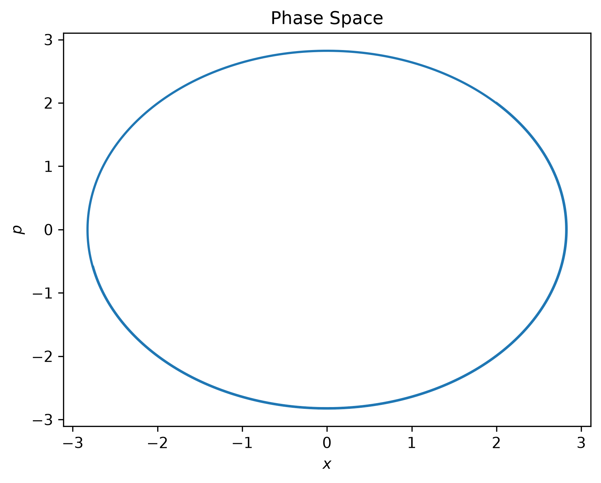
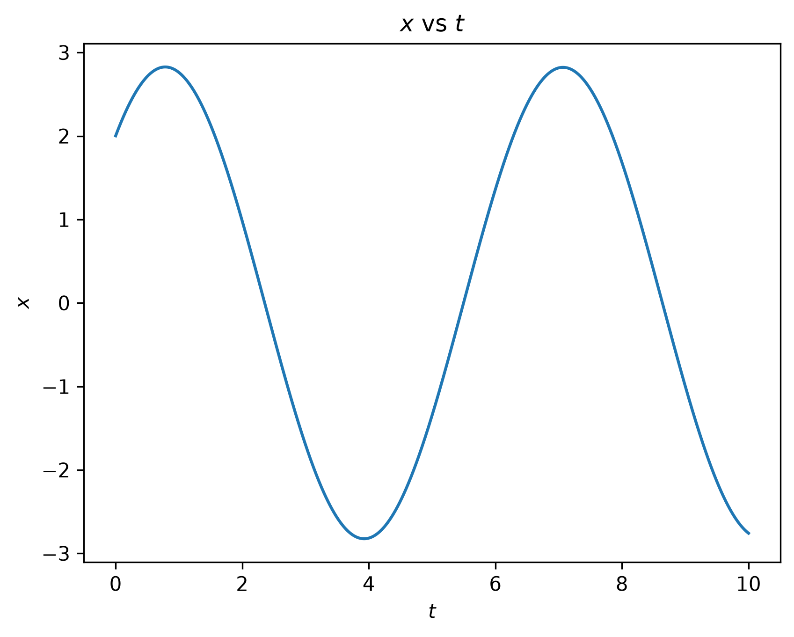

# Model 4
## Refining our Models using ਸੈਂਸ
Molecules move due to: thermal energy and intermolecular forces.\
$U(x)$ is the potential energy function (due to interaction of particles) and $K(p)$ is the kinetic energy function (related to thermal energy of particles).


We define the **Hamiltonian** as
$$\boxed{H(x, p) := U(x) + K(p)}$$
It represents the total energy of the system.\
Obviously,
$$\frac{\partial H}{\partial x} = \frac{\partial U}{\partial x}$$
$$\frac{\partial H}{\partial p} = \frac{\partial K}{\partial p}$$

<!-- Differentiating w.r.t time,
$$\frac{dH(x, p)}{dt} = \frac{dx}{dt}\frac{\partial H}{\partial x} + \frac{dp}{dt}\frac{\partial H}{\partial p}$$ -->

### Hamilton's Equations
Hamilton's equations are as follows:
$$\boxed {\frac{\partial H}{\partial x} = - \frac{dp}{dt}}$$
$$\boxed {\frac{\partial H}{\partial p} = \frac{dx}{dt}}$$
These hold regardless of conditions.\
> **Note:** These can be derived trivially for particle systems using Newtonian mechanics.

### Isolated Systems
In isolated systems, $H$ is constant,
$$\frac{dH}{dt} = 0$$

## OUR Model
Let, a particle moves on $x$-axis. Let, its motion is described by
$$U(x) = \frac{1}{2} k x^2$$
$$H(p) = \frac{p^2}{2m}$$
Then,
$$H = \frac{1}{2} k x^2 + \frac{p^2}{2m}$$
Using Hamilton's equations,
$$\frac{dp}{dt} = - \frac{\partial H}{\partial x} = - \frac{\partial U}{\partial x} = -kx = F$$
$$\frac{dx}{dt} = \frac{\partial H}{\partial p} = - \frac{\partial U}{\partial p} = \frac{p}{m} = v$$
By Taylor series expansion, we know,
$$x(t + \Delta t) = x(t) + \left. \frac{dx}{dt} \right|_{t} \Delta t + \frac{1}{2} \left. \frac{d^2x}{dt^2} \right|_{t} (\Delta t)^2 + ...$$
As $\Delta t \rightarrow 0$,
$$x(t + \Delta t) \approx x(t) + \left. \frac{dx}{dt} \right|_{t} \Delta t + \frac{1}{2} \left. \frac{d^2x}{dt^2} \right|_{t} (\Delta t)^2 = x(t) + \frac{p(t)}{m} \Delta t + \frac{1}{2} \frac{F(t)}{m} (\Delta t)^2$$
Similarly,
$$p(t + \Delta t) \approx p(t) + \left. \frac{dp}{dt} \right|_{t} \Delta t = p(t) + F(t) \Delta t$$

## Computed Results
```
k = 1.0
m = 1.0
dt = 0.001

x = 2.0
p = 2.0
F = -1 * k * x

N = 10000
```



It is obvious that phase space would be elliptical since,
$$\frac{x^2}{\frac{2H}{k}} + \frac{p^2}{2mH} = 1$$
We get
$$x_{max} = \sqrt{\frac{2H}{k}} \text{ when } p = 0$$
$$p_{max} = \sqrt{2mH} \text{ at } x = 0$$