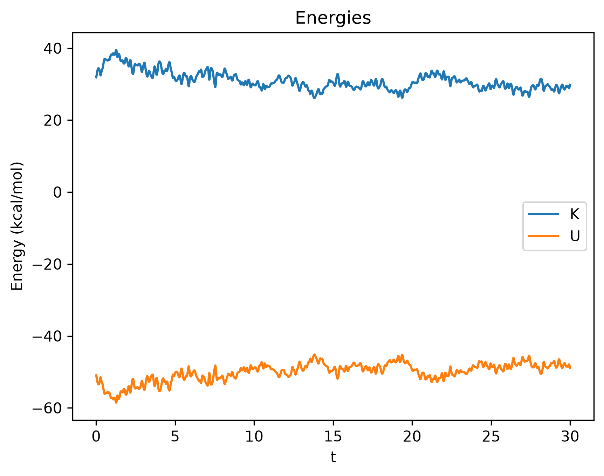
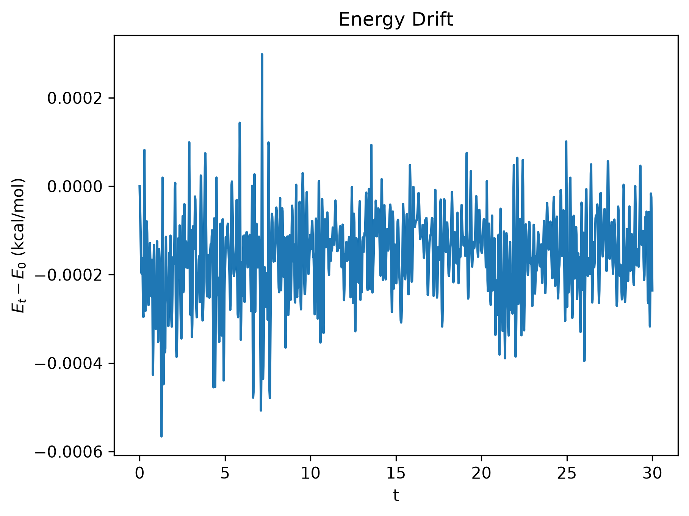
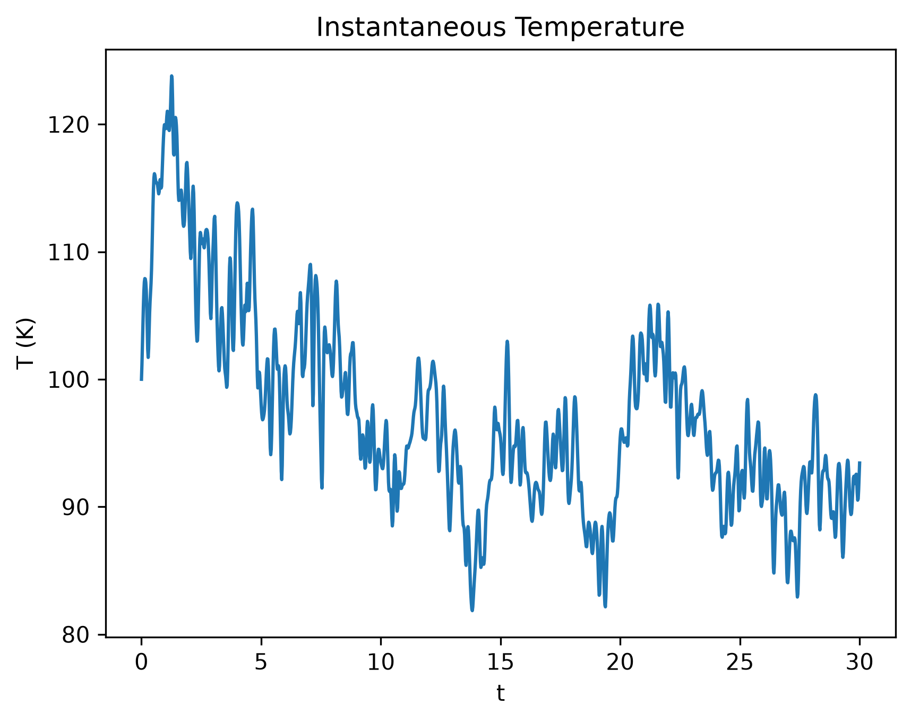

# Model 5
## Further Discussion on Hamiltonian Mechanics
By solving Hamilton's equations, we get trajectory of the given system in the phase-space.

For an isolated system, Hamiltonian (i.e., energy) is conserved:
$$H(x(t), p(t)) = E = H(x(0), p(0))$$
In above case, the phase-space trajectory is the fixed ellipse (called the **constant-energy curve**) we computed.

### Potential Energy
For model 4,
$$\frac{d^2U}{dx^2} = k$$
It is called **how shallow** or **steep of curve**.

### Entropy
Each point in phase-space defines a **microstate** of the system.\
Points on the ellipse is the set of accessible microstates. All other microstates (points) are inaccessible.

We define
$$\Omega(E) = \text{number of accessible microstates for energy E}$$

Experimentally,
$$S \propto \ln(\Omega(E))$$
$$\boxed{S = k_b \ln(\Omega(E))}$$

Boltzmann constant, $k_b = 1.38 \times 10^{-23} \space J/K$

We also know,
$$\Omega(E) \propto \text{circumference of ellipse} \propto \pi(a + b)$$
$$\Omega(E) \propto \sqrt E$$

## Model 5
### Description
We take 108 Argon atoms in a square box under Lennard-Jones potential.\
Potential energy $U$ is as follows:
$$U(\{\vec r\}) = \sum_{i=1}^{N-1} \sum_{j=i+1}^{N} U_{ij}$$
$$\boxed{U_{ij} = 4 \varepsilon \left[ \left( \frac{\sigma}{r_{ij}} \right)^{12} - \left( \frac{\sigma}{r_{ij}} \right)^6 \right]}$$
Here, $\varepsilon$ and $\sigma$ are constant parameters.\
And kinetic energy $K$ is as follows:
$$K(\{\vec p\}) = \sum_{i=1}^{N} \frac{p_i^2}{2m}$$

### Calculations
$$\boxed{\vec F_{ij} = \frac{24\varepsilon}{r_{ij}^2} \left( 2\left( \frac{\sigma}{r_{ij}} \right)^{12} - \left( \frac{\sigma}{r_{ij}} \right)^6 \right) \vec{r_{ij}}}$$
$$\vec{r_{ij}} = \vec{r_i} - \vec{r_j}$$

### Simulation
We will initialize positions maintaining a minimum distance (so that initial magnitude of LJ force doesn't explode).\
Then we initialize velocities given some initial target temperature.\
We use the above formulas to calculate forces, potential energy and kinetic energy at each step.\
And we use Verlet integration for calculating new positions and velocities.
#### Implementation Details
- We are working with velocities instead of momentums.
- We use a conversion factor to ease calculations.
- We set the net momentum to 0 so that system itself doesn't have a translational motion (it's not a big deal but not recommended).
- We output every `N_out = 10` steps.

### Computed Outputs

### Observations
Energy remains constant. This matches our expectation as system is isolated.

<!-- So Hamilton's equations for this system are
$$\frac{d \vec p_i}{dt} = -\frac{dH}{d \vec r_i}$$
$$\frac{d \vec r_i}{dt} = \frac{dH}{d \vec p_i}$$

Phase space for each particles would be chaotic (not random - deterministic but chaotic).

Solving $\frac{d \vec p_i}{dt}$,
$$TBDL$$

Solving $\frac{d \vec r_i}{dt}$,
$$TBDL$$ -->