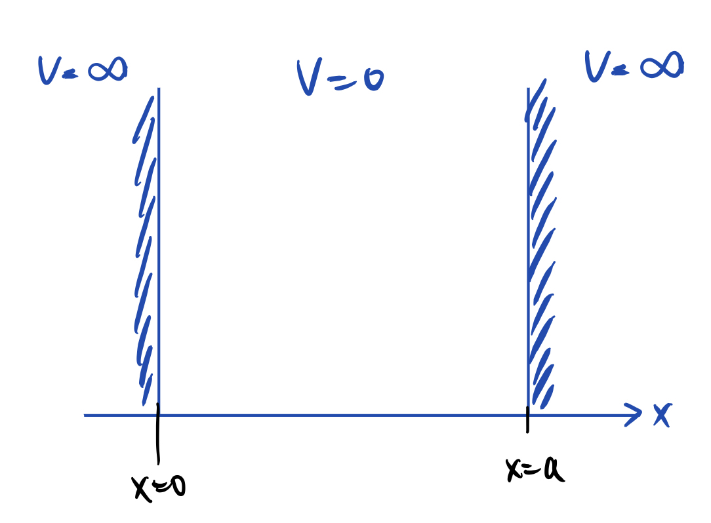
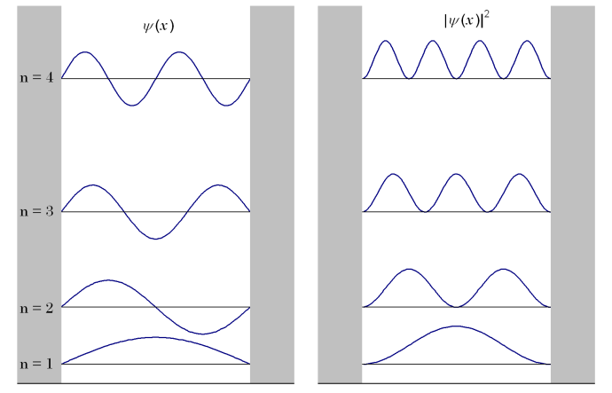

# Model 6
## Quantum Mechanics
A wavefunction is a \<thing> which describes the complete quantum state of a particle or an isolated system. It should be continuous, differentiable and single-valued.\
An observable property can be extracted from the wavefunction using an operator. Operator operated on the wavefunction returns the wavefunction times a constant called its **eigenvalue**. The equation is called **eigen equation**.
$$\boxed{ \hat{A}\psi = a\psi }$$

### Common Operators
We are only going to discuss time-independent systems.

#### Position
$$\hat{x} \equiv x$$

#### Momentum
$$\hat{p} \equiv -i \hbar \frac{d}{dx}$$

#### Kinetic Energy
$$\hat{K} \equiv \frac{\hat{p} \cdot \hat{p}}{2m} = -\frac{\hbar}{2m}\frac{d^2}{dx^2}$$

#### Energy
$$\hat{H} = \hat{K} + \hat{U}(\hat{x}) = -\frac{\hbar}{2m}\frac{d^2}{dx^2} + \hat{U}(\hat{x})$$

### Calculating Energy
#### Schrodinger's Equation
$$\hat{H}\psi(x) = E\psi(x)$$

#### Solving
$$-\frac{\hbar}{2m}\frac{d^2}{dx^2}\psi(x) + \hat{U}(\hat{x})\psi(x) = E\psi(x)$$

## OUR Model
### Description
We have a particle in a box. Particle can't exit the box and all positions inside the box are equivalent. So,
$$\hat{U}(\hat{x}) = \left \{  \begin{matrix} 0, 0 \lt x \lt L \\ \infty, x = 0, L\end{matrix}  \right .$$

### Calculating Wavefunction
For $x \in (0,L)$,
$$\hat{U}(\hat{x}) = 0$$
$$\implies -\frac{\hbar}{2m}\frac{d^2}{dx^2}\psi(x) = E\psi(x)$$
On solving, we get,
$$\psi(x) = A \cos (kx) + B \sin(kx)$$
Applying boundary condition: At $x = 0, L$,
$$\hat{U}(\hat{x}) = \infty \implies \psi(x) = 0$$
So,
$$\psi(x=0) = 0 \implies A = 0$$
$$\psi(x=L) = 0 \implies B \sin (kL) = 0 \implies k = \frac{n\pi}{L} \text{ for } n \in N^+$$
> **Doubt:** Isn't $\psi(x)$ only defined for $x \in (0,L)$? How are we setting $x = 0, L$?

Note that, $B = 0$ and $k = 0$ are physically impossible solutions (using them would imply that particle doesn't even exist).\
Therefore, we have
$$\psi_n(x) = B \sin \left( \frac{n\pi}{L} x \right)$$
We see that $n$ naturally emerges as a quantum number for the system.\
Applying normalization condition:
$$\int_0^L \psi^2(x) \,dx = 1$$
$$\implies B^2 \int_0^L \sin^2(kx) \,dx = 1$$
$$\implies \frac{B^2}{2} \int_0^L (1 + \cos (kx)) \,dx = 1$$
$$\implies \frac{B^2}{2} \left( L + \frac{1}{k} \left. \sin(kx) \right|_0^L \right) = 1$$
$$\implies \frac{B^2}{2} \left( L + \frac{1}{k} \sin \left( \frac{n\pi}{L}L \right) \right)  = \frac{B^2}{2} (L + 0) = 1$$
$$\implies B = \sqrt{\frac{2}{L}}$$
We finally get
$$\boxed{\psi_n(x) = \sqrt{\frac{2}{L}} \sin \left( \frac{n\pi}{L}x \right)} \text{ for } n \in N^+$$

### Calculating Observable Properties
#### Momentum
$$\hat{p} \psi_n(x) = -i \hbar \frac{d}{dx} \left(\sqrt{\frac{2}{L}} \sin \left( \frac{n\pi}{L}x \right) \right) = -i \hbar \frac{n \pi}{L}  \sqrt{\frac{2}{L}} \cos \left( \frac{n\pi}{L}x \right)$$
Therefore, $\hat{p} \psi_n(x) \neq p \psi_n(x)$ (RHS is a function of sine, while LHS is a function of cosine).\
So, we apply $\hat{p}$ again:
$$\hat{p}^2 \psi_n(x) = -i \hbar \frac{d}{dx} \left( -i \hbar \frac{n \pi}{L}  \sqrt{\frac{2}{L}} \cos \left( \frac{n\pi}{L}x \right) \right) = \left( \frac{n\pi\hbar}{L} \right)^2 \sqrt{\frac{2}{L}} \sin \left( \frac{n\pi}{L} x \right) = \left( \frac{n\pi\hbar}{L} \right)^2\psi_n(x) = p^2 \psi_n(x)$$
$$\boxed{p = \pm \left( \frac{n\pi\hbar}{L} \right) = \pm \left( \frac{nh}{2L} \right)}$$

#### Kinetic Energy
$$\hat{K}\psi_n(x) = \frac{\hat{p}^2}{2m}\psi_n(x)=K\psi_n(x)$$
$$K\psi_n(x) = \frac{1}{2m} \left( \frac{n\pi\hbar}{L} \right)^2 \psi_n(x)$$
$$\boxed{K = \frac{n^2 h^2}{8mL^2}}$$

$n = 1$ has the lowest energy. This is called the **ground state**.

### Graphs

Low energy - quantum behaviour\
High energy - classical behaviour\
It returns to classical state as $n \rightarrow \infty$.

## Resources
- [Wikipedia](https://en.wikipedia.org/wiki/Particle_in_a_box)
- [Chemistry LibreTexts](https://chem.libretexts.org/Bookshelves/Physical_and_Theoretical_Chemistry_Textbook_Maps/Supplemental_Modules_(Physical_and_Theoretical_Chemistry)/Quantum_Mechanics/05.5%3A_Particle_in_Boxes/Particle_in_a_1-Dimensional_box)
- [MIT OCW](https://ocw.mit.edu/courses/6-007-electromagnetic-energy-from-motors-to-lasers-spring-2011/187a737ba49baa8f397b80449a15e45a_MIT6_007S11_lec40.pdf)
- [Goalpara College](https://www.goalparacollege.ac.in/online/attendence/classnotes/files/1726037830.pdf)